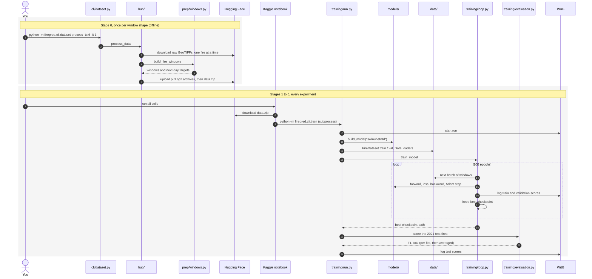
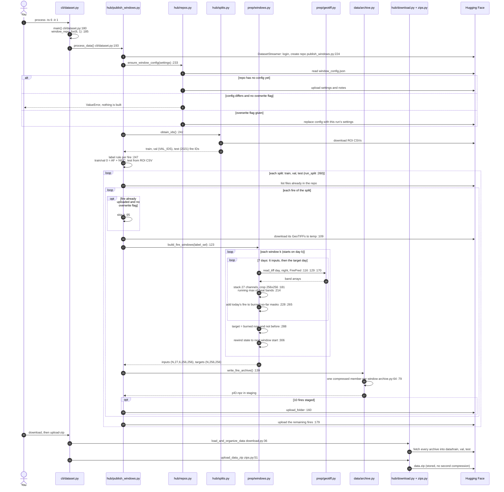
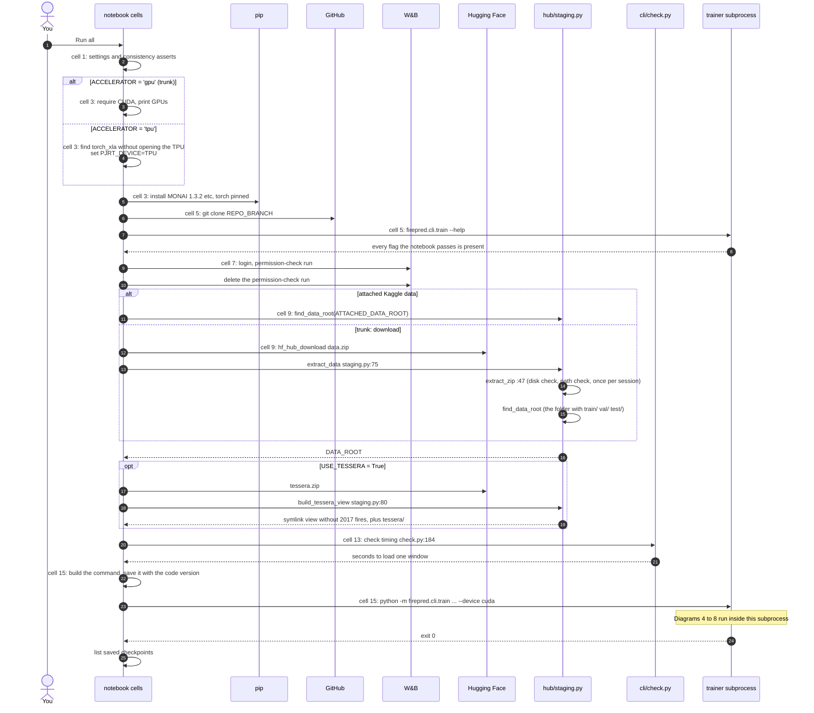
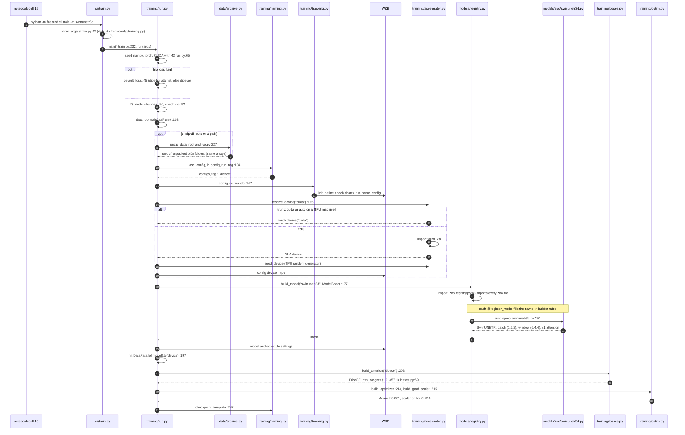
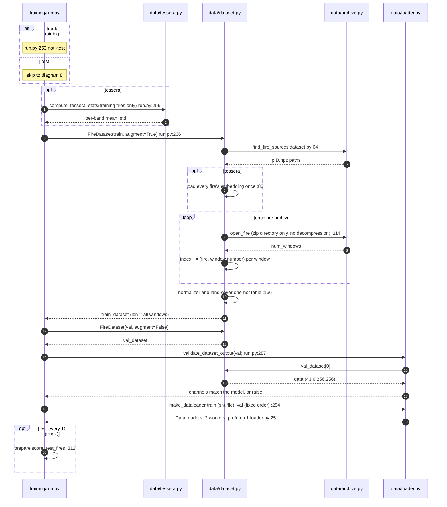
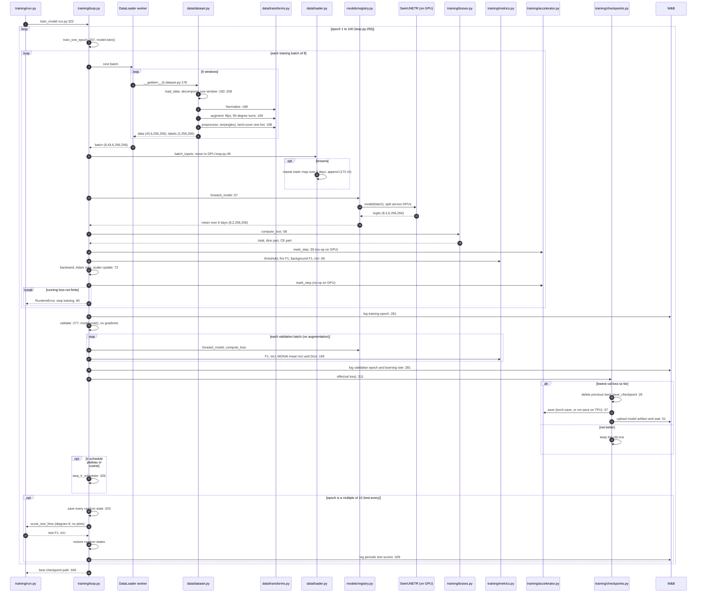
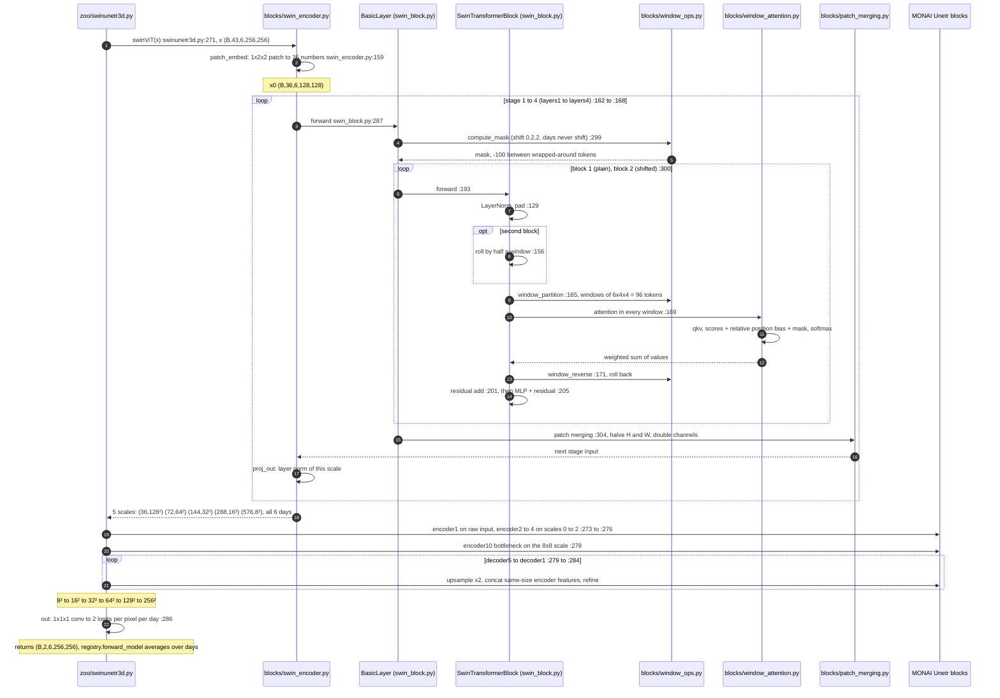
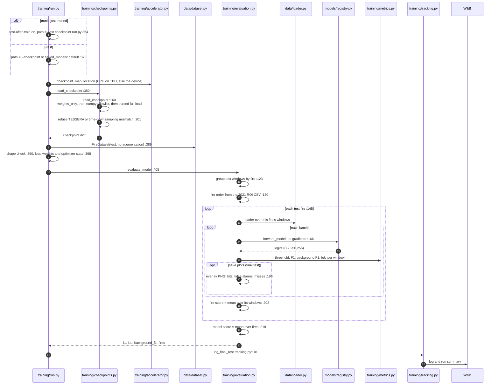
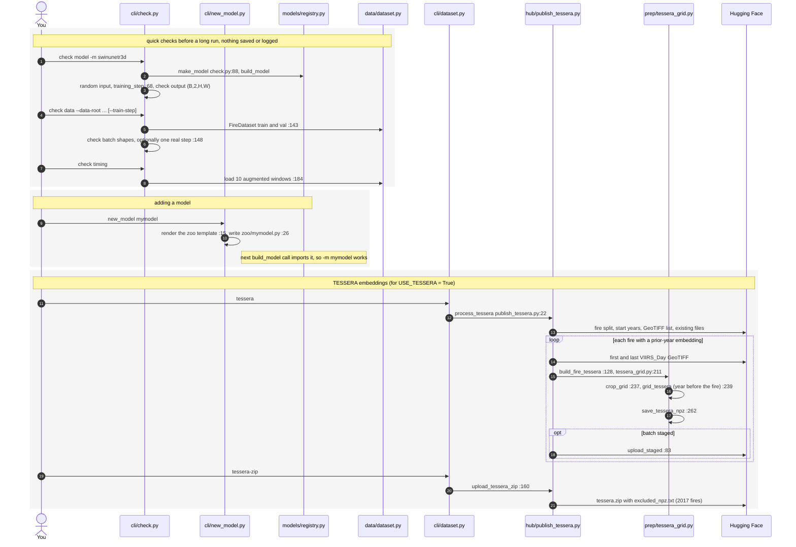

# Sequence diagrams

Who calls whom, in what order, for the whole program. These diagrams show the
same route as [EXECUTION_PATH.md](EXECUTION_PATH.md) (the trunk: Kaggle
notebook, GPU, `swinunetr3d`, Dice+CE, no TESSERA), drawn as calls between files.

How to read them:

- Each column is a file (or an outside service). Arrows are calls in time
  order, top to bottom; dashed arrows are return values. Numbers on the
  arrows count the steps.
- `file.py:123` in a label is the line that makes the call.
- `loop` boxes repeat. `alt` boxes take one of their routes, chosen by an input.
  `opt` boxes run only when their condition holds. `break` boxes stop the run.
- Diagram 1 is the whole program on one page. Diagrams 2–8 zoom into one stage
  each, in execution order. Diagram 9 covers the side entry points (`check`,
  `new_model`, TESSERA build).

The diagrams are Mermaid; GitHub and the VS Code Markdown preview render them.

1. [The whole program](#1-the-whole-program)
2. [Stage 0: building the dataset](#2-stage-0-building-the-dataset)
3. [Stage 1: the Kaggle notebook](#3-stage-1-the-kaggle-notebook)
4. [Stages 2–3: command line and run setup](#4-stages-23-command-line-and-run-setup)
5. [Stage 4: data objects](#5-stage-4-data-objects)
6. [Stage 5: the epoch loop](#6-stage-5-the-epoch-loop)
7. [Inside the model: one SwinUNETR-3D forward pass](#7-inside-the-model-one-swinunetr-3d-forward-pass)
8. [Stage 6: testing the best checkpoint](#8-stage-6-testing-the-best-checkpoint)
9. [Side entry points](#9-side-entry-points)

---

## 1. The whole program

---

## 2. Stage 0: building the dataset

`python -m firepred.cli.dataset process -ts 6 -it 1`, then `download` and
`upload-zip`. Step-by-step text: [EXECUTION_PATH.md, Stage 0](EXECUTION_PATH.md#stage-0-building-the-dataset-once-offline).

---

## 3. Stage 1: the Kaggle notebook

`notebooks/fire-research-swinunetr.ipynb` (local only). Cells hold settings;
all logic is in the cloned package.

---

## 4. Stages 2–3: command line and run setup

---

## 5. Stage 4: data objects

---

## 6. Stage 5: the epoch loop

`DataLoader worker` stands for the 2 loader processes that call
`FireDataset.__getitem__`. Diagram 7 opens up the `forward` arrow.

---

## 7. Inside the model: one SwinUNETR-3D forward pass

Shapes per GPU (B = 4 on 2 GPUs), F = 36. Step-by-step text:
[EXECUTION_PATH.md, stop 5.1c](EXECUTION_PATH.md#51-train-one-epoch) and
[docs/swinunetr3d/](swinunetr3d/).

---

## 8. Stage 6: testing the best checkpoint

---

## 9. Side entry points

The pieces that run outside the trunk. Each one starts its own process.

